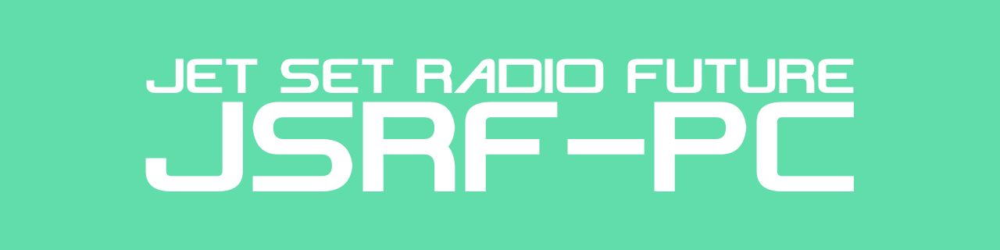

  

# JSRF-PC

JSRF-PC is a fork of upstream
[JSRF Unleashed](https://github.com/JuMatt/JetSetRadioFuture-Unleashed) by
[JuMatt](https://github.com/JuMatt). This fork aims to add various features and
bug fixes, whilst focusing on Linux and Windows compatibility.

> ⚠️ **Written by AI:** All of JSRF-PC's additions to the upstream code are
> written by AI, taking care to test features, fix bugs, and follow the
> project's structure.

**Jet Set Radio Future, statically recompiled to run natively on Linux and
Windows.** The game's own code is translated into C and built as a native
program.

**You need your own, legally acquired copy of the game.** This repository
contains no game files.

## Features

- **In-game menu:** F1, or Back on a controller, for the display, graphics,
  controller, and developer settings.
- **Resolution scaling:** 1× to 4×. _(JuMatt)_
- **Widescreen:** 16:9, in gameplay only. _(JuMatt)_
- **Free camera:** Modern right-stick camera controls and options, with the
  graffiti camera turned off. Reset with the left trigger.
- **Anti-aliasing:** SMAA _(JuMatt)_ and MSAA, alone or together.
- **Anisotropic filtering:** Sharper textures at an angle.
- **Portable mode:** Everything in one folder that can be moved.

## Download

The latest release is **b1.1-hotfix**, based on upstream JSRF Unleashed 0.5.6.

| Platform | File |
|---|---|
| Linux x86_64: SteamOS, Ubuntu 22.04+, and most modern distros. | [JSRF-PC-b1.1-hotfix-linux-x86_64.tar.gz](https://github.com/spriteice/JSRF-PC/releases/download/b1.1-hotfix/JSRF-PC-b1.1-hotfix-linux-x86_64.tar.gz) |
| Windows 10 or 11, x86_64. | [JSRF-PC-b1.1-hotfix-windows-x86_64.zip](https://github.com/spriteice/JSRF-PC/releases/download/b1.1-hotfix/JSRF-PC-b1.1-hotfix-windows-x86_64.zip) |

See the [changelog](CHANGELOG-JSRF-PC.md) for what changed in each version,
and the [releases](https://github.com/spriteice/JSRF-PC/releases) page for
every download.

## Installing

### Linux

1. Extract the archive anywhere.
2. Run `./jsrf-pc`. The first time, pick the folder with `default.xbe` in it,
   or your disc image (an XISO or a full disc image, usually `.iso`), which is
   unpacked once. It remembers your choice.
3. If you like, `./jsrf-pc --install` adds it to your applications menu.

### Windows

1. Extract the archive anywhere.
2. Run `JSRF-PC.exe`. It isn't signed, so the first time Windows may say it
   protected your PC: click More info, then Run anyway.
3. Pick the folder with `default.xbe` in it, or your disc image (an XISO or a
   full disc image, usually `.iso`), which is unpacked once. It remembers your
   choice.

### Saves, settings, and logs

- **Saves:** Kept in the game folder's `UDATA`, as on an Xbox. Copy it to back
  them up. A game played from a disc image keeps them in its unpacked copy,
  in `~/.local/share/jsrf-pc` on Linux or `%LOCALAPPDATA%\JSRF-PC` on Windows.
- **Settings and logs:** The `README.txt` in the download says where they are
  kept, and lists the launch options.
- **Portable mode:** Make a folder named `portable` next to the launcher, and
  the settings, saves, logs, and cache stay inside it. See
  [portable mode](docs/portable-mode.md).

### Your game

You need the **standalone USA (NTSC-U) disc**. No other version will work. All
game files must be legally acquired.

## Playing

Any controller SDL knows works, over USB or Bluetooth: Xbox, PlayStation,
Switch Pro, Steam Deck, and many more. The keyboard works too: W A S D to move,
the arrow keys for the camera, and Space to jump.
[Playing](docs/playing.md) has every key, the in-game menu, and the
graphics options. A controller is the recommended way to play.

## Status

Playable, early, and not yet played from start to finish. Linux is the main
target and the most tested. Windows comes second.

- **Works:** The title and menus, starting a new game, saving and loading,
  skating, grinding, tricks, graffiti, music, sound, and voices. The tutorial,
  The Garage, Dogenzaka Hill, Shibuya Terminal, and 99th Street are tested the
  most.
- **Partly works:** Widescreen 16:9. The game view mostly works, but some menus
  and effects are still 4:3 or stretched.
- **Little tested:** The later areas, so expect bugs.
- **Known issues:** Each is described in the
  [latest release's notes](https://github.com/spriteice/JSRF-PC/releases/latest).
  - The jet boost effect in widescreen.
  - Some elements half a pixel out of place.
  - Sound from one side between menus (intermittent).
  - Music stopping in the Graffiti picker (intermittent).
  - Black screenshots on Windows.

**Found a bug?** [Open an issue](https://github.com/spriteice/JSRF-PC/issues)
and attach the `last-run.log` from that run.

## How it works

The game's x86 code is translated, function by function, into C and compiled
for your CPU, so its logic runs at native speed with no interpreter or JIT.
The Xbox hardware it talks to, the NV2A graphics chip, the MCPX audio chip, and
the kernel, is still emulated, using the
[xboxrecomp toolkit](docs/xboxrecomp-toolkit.md) and [xemu](https://xemu.app)'s
hardware models.

## Building from source

The generated code is made from the game's program, so it is never in this
repository: you make it on your own machine, from your own `default.xbe`.
[Building on Linux](docs/building-on-linux.md) has every step, and how the
Windows build is cross-compiled.

## Legality

The releases contain only the engine: a native program the recompiler derived
from the game's code. It contains **no game data** and does nothing without
the files from your own copy of the game. This repository holds no game code
at all, only the tools to recompile the game's code from your own disc.

*Jet Set Radio Future* is © SEGA. This is an unofficial fan project, not
affiliated with or endorsed by SEGA. If you represent a rights holder and have
a concern, please open an issue.

## Licence

MIT for this project's own code; the MCPX audio-processor code extracted from
xemu is LGPL-2.1-or-later. See [LICENSE](LICENSE) and [NOTICE](NOTICE).

## Credits

- [JuMatt](https://github.com/JuMatt): the original port,
  [JSRF Unleashed](https://github.com/JuMatt/JetSetRadioFuture-Unleashed),
  which this fork builds on, with the original widescreen and resolution
  scaling.
- [xboxrecomp](https://github.com/sp00nznet/xboxrecomp): the static
  recompilation toolkit this is a port on top of. Its documentation is kept at
  [docs/xboxrecomp-toolkit.md](docs/xboxrecomp-toolkit.md).
- [xemu](https://xemu.app): the NV2A and MCPX APU hardware models, without
  which none of the graphics or audio would exist.
- [Dear ImGui](https://github.com/ocornut/imgui): the library the in-game menu
  is built with.
- The title lettering in the banner is set in
  [Nise JSRF](https://www.dafont.com/nisejsrf.font), a free font by Yoyo.
- Smilebit and SEGA, who made the game.
